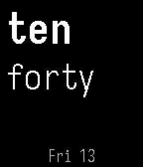
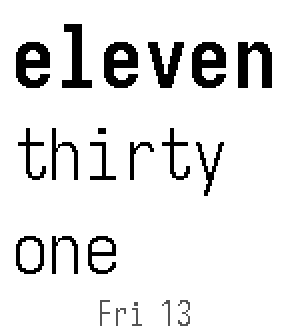
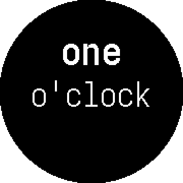
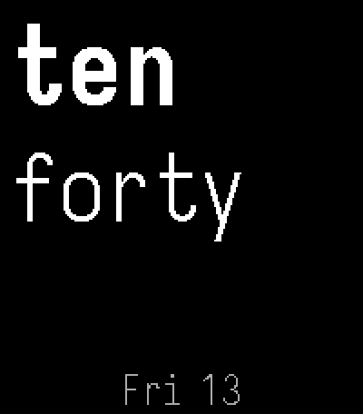
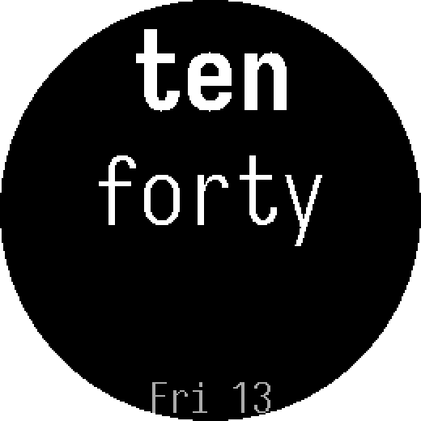

<h1 align="center">Ten Forty</h1>

<p align="center"><em>The time, spelled. Three stacked words in Iosevka —<br>
the hour bold, the minutes light.</em></p>

<p align="center">
  
  
  
</p>

---

Ten Forty is a watchface for Pebble. No digits, no hands, no ticks, no
complications: `ten` / `forty`, and nothing else unless you ask it for the
date. Two rows at ten forty. Three at eleven thirty-one. That is the whole
face.

It is set in [Iosevka](https://github.com/be5invis/Iosevka), monospaced, so a
row is exactly as wide as its letters and changing case never moves anything.
The hour carries the weight; the minutes are light, and the eye reads them as
one sentence broken over three lines.

## Build

```sh
cd ten-forty
./scripts/fetch-fonts.sh
pebble build
pebble install --emulator basalt
```

`fetch-fonts.sh` pulls Iosevka, which is 24MB and not committed. `pebble
build` writes `build/ten-forty.pbw`.

On a watch, turn on **Dev Connection** in the Pebble app and use
`pebble install --cloudpebble`. There is no store listing yet.

## Platforms

Basalt, flint, chalk, emery and gabbro. The 1-bit screens — aplite and
diorite — are not targeted: three custom fonts do not fit in 24KB of heap.

<p align="center">
  
  
</p>

## Settings

Nine, all of them presentational, all of them persisted on the watch. The
phone page is at
[damosullivan.github.io/ten-forty/config.html](https://damosullivan.github.io/ten-forty/config.html).

| Setting | Values |
|---|---|
| Theme | white on black, black on white |
| Alignment | left, centre, right — words and date separately |
| Date | hidden, top or bottom — `Tue 10` · `10 Nov` · `Tue 10 Nov` · `Tuesday` |
| Single-digit minutes | `seven oh five` or `seven five` |
| Font weight | light or regular |
| Letter case | lowercase, UPPERCASE, Capital |
| Transition | none, every row, or the hour only |

The hour slides by default. So does the date when the day turns over.

## Notes

**Thirteen takes a hyphen.** A row holds seven characters at the minute size,
so the eight-letter teens are cut across the two minute rows. *four*, *seven*,
*eight* and *nine* read as two fragments the eye joins by itself. *thir* does
not, so thirteen alone is `thir-` — the mark for a word broken across a line.

**The circle is the reason chalk runs smaller.** The top row's ascenders sit
where a round screen is narrowest, so anything tall at the left edge loses its
tip. Round platforms therefore set smaller type, and centre the words by
default.

**There is no 24-hour mode.** Spelled out it does not fit: *seventeen* wants a
30px font and *twenty-three* a 22px one, against 37px normally. It would need
a different idea, not a setting.

More in [AGENTS.md](AGENTS.md): the design decisions, the gotchas, and the
things that were tried and removed. Store copy is in
[ten-forty/STORE.md](ten-forty/STORE.md).

## Licence

MIT. The word-splitting and slide approach comes from Pebble's `sliding-text`
example; the notice is in [LICENSE.md](LICENSE.md) and travels with the code.
Iosevka is under the SIL Open Font License 1.1.
