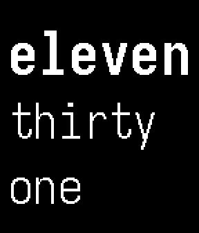
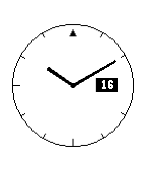

# Pebble

Watch faces for Pebble. One repo, shared tooling, one face per directory.

<p align="center">
  
  
</p>

- **[Ten Forty](ten-forty/)** — the time, spelled in three stacked words.
  [Store](https://apps.repebble.com/719f27f4b48048d080225d6b) ·
  [Build and settings](ten-forty/DEVELOPING.md) ·
  [Design notes](ten-forty/AGENTS.md)
- **[Bauhaus](bauhaus/)** — a quiet instrument dial built from the watch's own
  primitives. [Build](bauhaus/README.md) · [Spec](bauhaus/SPEC.md) ·
  [Design notes](bauhaus/AGENTS.md) · [Store copy](bauhaus/STORE.md).

## Build

```sh
export PATH="$HOME/.local/share/uv/tools/pebble-tool/bin:$PATH"

./scripts/build-all.sh          # every face that has a wscript
cd ten-forty && pebble build    # or one at a time
```

Each face is a self-contained Pebble project with its own `package.json`,
`wscript`, UUID, version and store listing. The repo root only holds the shared
notes, tooling and the GitHub Pages tree.

Publishing, store rules and the platform gotchas are in [AGENTS.md](AGENTS.md).
