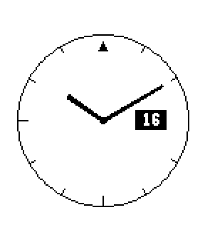
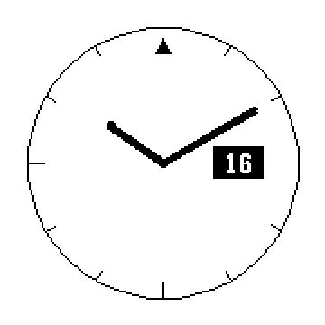
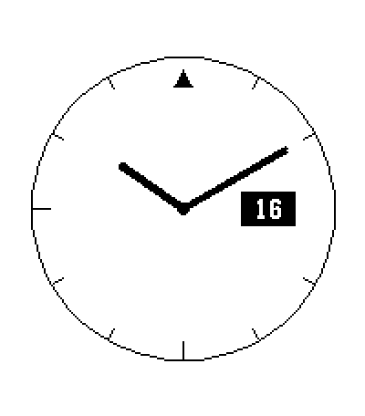
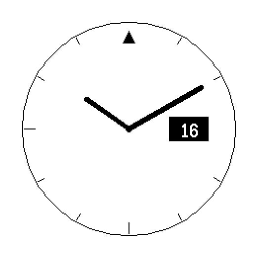

# Bauhaus

A quiet instrument dial for Pebble, built from the watch's own primitives.

<p align="center">
  
  
  
  
</p>

A white dial, a thin black ring, ten ticks and a triangle at 12, plain baton
hands and a black date window at 3. No numerals, no logo, no second hand, no
animation, no settings. The line gives the time, the triangle marks 12 and the
square holds the date.

Everything is drawn with vector primitives and the system font. That includes
the 1-bit screens: aplite and diorite run the same face as the colour watches.

## Build

```sh
export PATH="$HOME/.local/share/uv/tools/pebble-tool/bin:$PATH"
pebble build
pebble install --emulator basalt
```

Targets aplite, basalt, flint, chalk, diorite, emery and gabbro.

## Read more

- [SPEC.md](SPEC.md) — the design principles and the idea.
- [AGENTS.md](AGENTS.md) — measured geometry, drawing decisions, platform notes.
- [STORE.md](STORE.md) — listing copy and release checks.
- [reference/sheet.png](reference/sheet.png) — the concept sheet.
